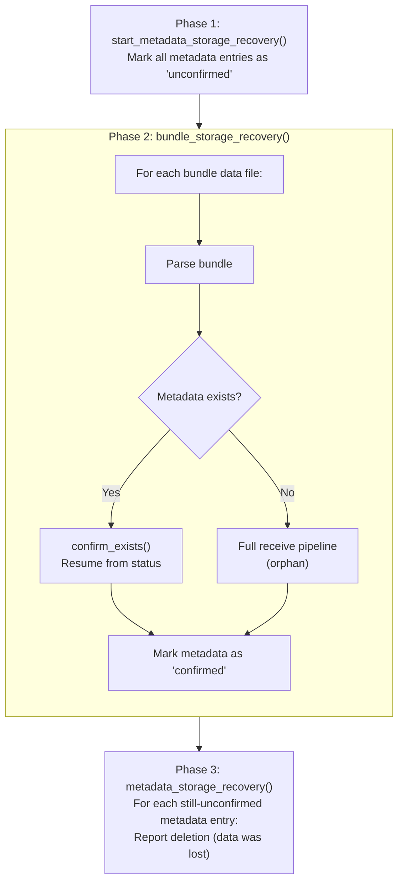

# Storage Subsystem Design

This document describes the storage subsystem in the BPA, covering the dual storage model, caching, expiration monitoring, and crash recovery.

## Related Documents

- **`BundleStatus`** (rustdoc in `bpa/src/bundle/status.rs`): Bundle status values stored in metadata, and their transitions
- **[Filter Subsystem Design](filter_subsystem_design.md)**: classification persistence (no filter mutation is ever persisted)
- **[Policy Subsystem Design](policy_subsystem_design.md)**: Hybrid channels for queue management
- **[Routing Design](routing_subsystem_design.md)**: Route changes trigger `reset_peer_queue()`

## Overview

The storage subsystem provides persistent and cached storage for bundles, coordinating between separate data and metadata backends:

| Component | Purpose |
|-----------|---------|
| **Store** | Central coordinator for all storage operations |
| **BundleStorage** | Binary bundle data persistence (blobs) |
| **MetadataStorage** | Bundle state and lifecycle tracking |
| **LRU Cache** | In-memory bundle data for fast access |
| **Reaper** | Lifetime expiration monitoring |
| **Channels** | Hybrid fast/slow path queue management |

## Architecture Diagram

```
┌─────────────────────────────────────────────────────────────────────┐
│                            Store                                    │
│                                                                     │
│  ┌─────────────────┐  ┌─────────────────┐  ┌─────────────────────┐  │
│  │ Recent-ID Cache │  │  Reaper Cache   │  │  Channel Manager    │  │
│  │  (duplicates)   │  │  (expiry times) │  │  (fast/slow path)   │  │
│  └─────────────────┘  └─────────────────┘  └──────────┬──────────┘  │
│                                                       │             │
└───────────┬────────────────────┬──────────────────────┼─────────────┘
            │                    │                      │
            ▼                    ▼                      ▼
┌─────────────────────┐  ┌─────────────────┐  ┌─────────────────────┐
│ CachedBundleStorage │  │ MetadataStorage │  │   Dispatcher        │
│ (LRU decorator)     │  │ (trait)         │  │                     │
├─────────────────────┤  ├─────────────────┤  │  - drop_bundle()    │
│ wraps a backend:    │  │ - sqlite-storage│  │  - restart_bundle() │
│ - localdisk-storage │  │ - postgres      │  │  - poll_waiting()   │
│ - s3-storage        │  │ - metadata_mem  │  │                     │
│ - bundle_mem        │  │                 │  │                     │
└─────────────────────┘  └─────────────────┘  └─────────────────────┘
```

## Store Coordinator

The `Store` struct is the central coordinator for all storage operations. It holds references to both storage backends — a configured bundle backend is usually wrapped in the `CachedBundleStorage` LRU decorator, which owns the bundle-data cache — manages the reaper cache and the recently-committed id cache behind the input gates' advisory duplicate probe, and coordinates recovery.

**Lock Strategy:**

- `spin::Mutex` for the bundle-data LRU inside the `CachedBundleStorage` decorator (O(1) operations, no blocking)
- Standard `Mutex` for reaper_cache (requires O(n) iteration)
- `spin::Mutex` for the recently-committed id cache (O(1) LRU operations, no blocking)

## Storage Traits

The storage subsystem defines two core traits that backends must implement. See rustdoc for full API details.

### BundleStorage

The `BundleStorage` trait manages binary bundle data as opaque blobs. Implementations handle recovery (walking stored files), load/save by storage name, and deletion. The trait is designed for large data with infrequent access.

### MetadataStorage

The `MetadataStorage` trait manages bundle lifecycle state with indexed queries. Key operations include:

- **CRUD**: get, insert, tombstone (prevents re-insertion)
- **Recovery**: start_recovery, confirm_exists, remove_unconfirmed
- **Queue management**: reset_peer_queue (ForwardPending → Waiting)
- **Polling**: poll_expiry, poll_waiting, poll_pending for background processing

### Streaming results via `Sender<T>`

Polling methods on both traits stream results back to the caller via a `Sender<T>` sink rather than returning a collection. The trait describes *what* is communicated — a sequence of bundles or recovery responses — without committing to any particular channel type for *how* they are delivered.

The trait's predecessor was a type alias resolving directly to `flume::Sender<T>`. Every implementation of `MetadataStorage` and `BundleStorage` therefore had to depend on flume directly, and a backend with a different internal model had no escape: localdisk-storage's recovery walk runs synchronously inside a blocking task and uses flume's blocking `send` + `is_disconnected` API, while the in-memory backends and the SQLite backend use only async sends. Coupling these two backend styles to a single channel API forced awkward compromises in either direction. It also propagated the BPA's channel choice into every backend crate, so any future change (such as the eventual flume → `hardy_async::channel` migration that motivated this redesign) would cascade through the whole workspace.

`Sender<T>` is a small trait with one async `send` method that returns an error wrapping the rejected item when the consumer has gone away. Each consumer implements the trait on whatever transport is convenient: a `hardy_async::channel::Sender` implements `Sender<T>` directly via a blanket impl, so BPA call sites pass one straight into a polling method; localdisk-storage's `recover()` keeps its blocking flume channel internally and runs a small bridge pump task that forwards items from the flume receiver to the external `Sender`; the shared test suite uses a `Mutex<Vec<T>>`-based collector for assertions. None of these implementations leak into the trait surface — they're free to evolve independently.

The trait is passed as `&dyn Sender<T>` rather than as a method-level generic parameter. A generic method would force `MetadataStorage` and `BundleStorage` to lose their object-safety, which would cascade through the BPA: the central `Store` holds storage backends as `Arc<dyn MetadataStorage>` (chosen at runtime based on configuration), and that pattern would no longer compile. The cost of `&dyn` is one indirect call per item streamed, which is negligible relative to anything the storage backend itself does.

#### Naming: `Sender`, not `Sink`

Hardy already uses the name `Sink` for a structurally different pattern: the long-lived, multi-method back-channels that CLAs, Services, and RoutingAgents receive when they register with the BPA. A `cla::Sink` lives for the duration of the registration and exposes several methods (forward, dispatch, error reporting). Reusing `Sink` for the storage abstraction would invite confusion between the two patterns even though their architectural intent — decouple the trait from the underlying transport — is the same.

`Sender<T>` mirrors [`hardy_async::channel::Sender`](../../async/src/channel.rs) deliberately: the trait is the abstract version of the same role at the channel layer (one async `send`, ownership-recovering error on disconnect), and most implementors wrap exactly such a channel. The name pairs with the `Receiver<T>` pull-side trait beside it in `crate::stream` — the same Sender/Receiver split as `hardy_async::channel`, at the trait level — through which the input doors pull bundle `Segment`s into the BPA.

#### Connection to streaming chunks

The longer-term direction for BPA payload handling is end-to-end streaming: payload bytes flow through pipelines chunk-by-chunk rather than buffering whole bundles in memory. `Sender<T>` is the smallest expression of that direction — when the streaming pipeline lands, `Sender<Chunk>` is a natural shape using exactly the same trait.

## Dual Storage Model

Bundle data and metadata are stored separately:

```
┌─────────────────────────────────────────────────────────────────┐
│                         Bundle                                  │
│                                                                 │
│  ┌─────────────────────────┐  ┌──────────────────────────────┐  │
│  │     Binary Data         │  │        Metadata              │  │
│  │                         │  │                              │  │
│  │  - CBOR-encoded bundle  │  │  - storage_name (pointer)    │  │
│  │  - Stored by blob key   │  │  - status (New, Waiting...)  │  │
│  │                         │  │  - received_at               │  │
│  │  Backend:               │  │  - ingress_peer_node/addr    │  │
│  │  - localdisk-storage    │  │  - classification, epoch     │  │
│  │  - bundle_mem           │  │                              │  │
│  │                         │  │  Backend:                    │  │
│  │                         │  │  - sqlite-storage            │  │
│  │                         │  │  - metadata_mem              │  │
│  └─────────────────────────┘  └──────────────────────────────┘  │
│                                                                 │
│  Linked by: metadata.storage_name → bundle_storage key          │
└─────────────────────────────────────────────────────────────────┘
```

### Why Separate Storage?

1. **Different access patterns**: Metadata accessed frequently (status checks), data accessed rarely (forwarding)
2. **Different backends**: Relational (SQLite, PostgreSQL) for indexed queries, blob stores (filesystem, S3) for large data
3. **Independent scaling**: Metadata on fast SSD, data on high-capacity storage
4. **Crash safety**: Atomic operations on each backend independently

## Storage Backends

### Localdisk Storage (Bundle Data)

**Location:** [`localdisk-storage/src/storage.rs`](../../localdisk-storage/src/storage.rs)

Directory structure with 2-level hierarchy:

```
store_dir/
  XX/
    XX/
      <storage_name>
```

**Features:**

- **Atomic writes** (with `fsync=true`): Write to `.tmp`, fsync, rename, fsync directory
- **Memory-mapped loading** (with `mmap` feature): Zero-copy via `memmap2::Mmap`
- **Parallel recovery**: Thread pool walks directories concurrently

Configuration includes the storage directory path and whether to use atomic writes (fsync). See the [localdisk-storage design doc](../../localdisk-storage/docs/design.md) for details.

### SQLite Storage (Metadata)

**Location:** [`sqlite-storage/src/storage.rs`](../../sqlite-storage/src/storage.rs)

**Features:**

- Connection pool with write lock
- Prepared statement caching
- Status encoding as (code, param1, param2, param3) tuple

**Status Encoding:**

| Status | Code | Params |
|--------|------|--------|
| `New` | 0 | - |
| `Waiting` | 1 | - |
| `ForwardPending` | 2 | peer, queue, next_hop |
| `AduFragment` | 3 | timestamp, sequence, source_eid |
| `Dispatching` | 4 | - |
| `WaitingForService` | 5 | -, -, service_eid |
| `ForwardAckPending` | 6 | peer |
| `DispatchPending` | 7 | - |
| `DeliverPending` | 8 | -, -, service_eid |
| `DeliveryAckPending` | 9 | -, -, service_eid |

Configuration includes the database directory and name. See the [sqlite-storage design doc](../../sqlite-storage/docs/design.md) for details.

### PostgreSQL Storage (Metadata)

**Location:** [`postgres-storage/src/storage.rs`](../../postgres-storage/src/storage.rs)

Implements `MetadataStorage` using PostgreSQL via `sqlx`, enabling shared metadata across multiple BPA instances. Uses connection pooling (`sqlx::PgPool`) and automatic schema migration. See the [postgres-storage design doc](../../postgres-storage/docs/design.md) for details.

### S3 Storage (Bundle Data)

**Location:** [`s3-storage/src/storage.rs`](../../s3-storage/src/storage.rs)

Implements `BundleStorage` using the Amazon S3 API via `aws-sdk-s3`, storing each bundle as a separate object under a configurable prefix. Compatible with MinIO and other S3-compatible stores. See the [s3-storage design doc](../../s3-storage/docs/design.md) for details.

### In-Memory Storage (Testing)

**Bundle:** `src/storage/bundle_mem.rs` - byte-capacity LRU; when over capacity, least-recently-used bundles are evicted (a `min_bundles` floor, clamped to at least 1, protects the most recent saves).
**Metadata:** `src/storage/metadata_mem.rs` - bounded LRU keyed by bundle ID; a tombstone records the deleted bundle's expiry and, while unexpired, is live de-duplication state that ages out of the LRU like any other entry, whereas a tombstone written for an already-expired bundle is demoted to the LRU tail so capacity evictions consume it first (a late duplicate of an expired bundle is itself expired and is refused at ingress); eviction of an already-expired bundle is accounted as housekeeping rather than data loss.

Both stores warn at startup that contents do not survive a restart, and emit edge-triggered `info` lines when occupancy crosses 95% of capacity and again when it falls back below 90%, so sustained pressure produces two log lines per episode rather than one per eviction.

## LRU Cache Management

Bundle data is cached by `CachedBundleStorage`, an in-memory LRU decorator the builder wraps around a configured `BundleStorage` backend (the default in-memory store is never cached, and `BpaBuilder::no_cache` disables it). Configuration controls the cache capacity (default: 1024 entries) and maximum bundle size to cache (default: 16 KB).

### Cache Operations

| Operation | Strategy | Cache Behavior |
|-----------|----------|----------------|
| **Load** | Cache-first | Pop a cached entry (the returned buffer is then usually uniquely owned), else load from the backend without re-populating the cache |
| **Save** | Persist-first | Always persist to backend, cache if size < `max_cached_bundle_size` |
| **Delete** | Cache-then-backend | Remove from cache, then delete from backend |

See `CachedBundleStorage` in `src/storage/bundle_cache.rs` for implementation.

## Reaper (Expiration Monitoring)

The reaper monitors bundle lifetimes and triggers deletion on expiry (`src/storage/reaper.rs`).

### Two-Level Cache Architecture

```
┌─────────────────────────────────────────────────────────────────┐
│                    Reaper Cache (in-memory)                     │
│                                                                 │
│  BTreeSet<CacheEntry> ordered by expiry time                    │
│  Limited size (= poll_channel_depth)                            │
│  Keeps bundles with soonest expiry                              │
│                                                                 │
│  When full: evict entry with latest expiry (keep soonest)       │
└─────────────────────────────────┬───────────────────────────────┘
                                  │ refill when empty
                                  ▼
┌─────────────────────────────────────────────────────────────────┐
│                  MetadataStorage (persistent)                   │
│                                                                 │
│  poll_expiry(stream) returns bundles ordered by expiry          │
│  Full list of all bundles with lifetimes                        │
└─────────────────────────────────────────────────────────────────┘
```

### Cache Entries

Each cache entry tracks a bundle's expiry time, ID, and destination. The BTreeSet orders entries by expiry time → destination → ID for deterministic ordering.

### Reaper Loop

The reaper runs as a background task with the following behavior:

1. **Sleep** until the next bundle expiry (or indefinitely if cache is empty)
2. **Wake** on: shutdown signal, new bundle notification, or expiry timeout
3. **Expire** all bundles past their lifetime via `drop_bundle()`, except in-flight hand-offs (`ForwardAckPending`, `DeliveryAckPending`), which cannot be recalled and resolve their expiry when the hand-off does
4. **Refill** cache from storage when depleted

The hand-off exemption keeps the BPA from reporting what it cannot make true. Work in an external party's hands cannot be recalled, so a bundle that expires while a service consumes it in `on_deliver` reports *delivered*, not "deleted: lifetime expired", and a transfer the CLA completes is not reported deleted. Expiry is enforced at checkpoints instead: dispatch checks before acting on a bundle, and delivery checks before `on_deliver`, so a hand-off never commences for an already-expired bundle. Reaping only the parked statuses (`Waiting`, `WaitingForService`) was rejected: `AduFragment` and backpressured `*Pending` queues are unbounded pauses too, and reaping a queued status is always truthful under the claim-CAS discipline. The refill skips the hand-off statuses, so a held-open hand-off cannot spin it; their exits re-arm the watch.

The reaper uses `select_biased!` to prioritize shutdown handling. See `Reaper::run()` in `src/storage/reaper.rs` for implementation.

### Watch Bundle

When a bundle enters the system, it's registered with the reaper via `watch_bundle()`:

1. Create a `CacheEntry` with expiry time, bundle ID, and destination
2. Insert into the BTreeSet cache (evicts latest expiry if full)
3. Wake the reaper if this bundle has the soonest expiry

This ensures bundles with imminent expiry are always tracked in the in-memory cache.

## Crash Recovery

Three-phase recovery process on startup (`src/storage/recover.rs`):

### Phase 1: Start Recovery

Call `start_metadata_storage_recovery()` to prepare the metadata backend:

- **SQLite**: Marks all bundle entries as "unconfirmed"
- **In-memory**: No-op

### Phase 2: Bundle Storage Recovery

Call `bundle_storage_recovery()` to scan all stored bundle data:

1. Walk storage directory, emitting `(storage_name, timestamp)` pairs
2. For each bundle, call `restart_bundle()` to determine status:

| Condition | Result | Action |
|-----------|--------|--------|
| Data + metadata exist | `Valid` | Resume from status checkpoint |
| Data exists, no metadata | `Orphan` | Full receive pipeline (`process_received_bundle`) |
| Duplicate data found | `Duplicate` | Delete spurious copy |
| Data unparseable | `Junk` | Delete data |
| Data missing | `Missing` | Skip (race condition) |

### Phase 3: Metadata Recovery

Call `metadata_storage_recovery()` to find orphaned metadata:

1. Query for bundles still marked "unconfirmed" (data was lost)
2. Report each as deleted with `DepletedStorage` reason

See `src/storage/recover.rs` for implementation details.

### Recovery Diagram



### Recovery on Demand (Proposal)

Recovery runs only when the operator starts the server with `--recover-store`. A start without the flag runs none of the three phases, whatever state the last run left the stores in, so a node that crashes and is restarted by its supervisor carries on unchecked. This proposal makes recovery something the stores ask for.

**Each store says, when it opens, whether its last run closed it in order.** Both storage traits gain the same pair: an answer returned when the store is opened, and a shutdown call. A backend records "closed in order" durably when the BPA calls its shutdown, and withdraws the record when it next opens, so the record is written twice a run and its absence at open means the last run ended some other way: a kill, a panic, a power loss. The absence asks for recovery whether or not anything was in flight. A run that ended without closing its stores has given no account of what it was doing, and checking is cheap beside being wrong. The opposite sense, a record made at open and withdrawn at close, is rejected: a store that has never held the record would read as closed in order and skip the recovery it most needs.

**The BPA runs recovery when either store asks.** The three phases cross-check the two stores, so they run in full or not at all: bundle data with no metadata, and metadata with no data, are each found only by walking one store against the other. Recovery is skipped only when both stores answer that they closed in order. `--recover-store` becomes the way to force recovery whatever the stores answer, for a store restored from a backup or edited by hand, which no record made by the store can detect.

**The BPA calls shutdown once it has stopped saving.** The call is the last step of the BPA's own shutdown, metadata store first, then bundle store. It is a trait method because the record must not be written by a run that is dying: writing it when the backend is dropped is rejected, since a drop runs while a panic unwinds. A backend whose shutdown is never called never has the record, and asks for recovery at every start, which costs time and is safe.

**The record is each backend's own.** The traits fix what the answer means, not how it is kept:

| Backend | How "closed in order" is kept |
| --- | --- |
| Local disk | An empty `.clean` file in the store directory (see the [localdisk-storage design](../../localdisk-storage/docs/design.md#recovery-independent-of-the-clock)) |
| SQLite | A row in a one-row table, written in the shutdown transaction and deleted, in its own committed transaction, before the first write of the next run |
| PostgreSQL | The same row. A database shared by several BPA instances needs one row per instance, keyed by an identity the instance keeps across restarts, which nothing provides today |
| S3 | An object under the store's key prefix |
| In-memory | Nothing to keep: the store is empty at every start, and answers that no recovery is needed |

The SQLite and PostgreSQL row belongs with the node-state ledger of [`storage_consistency_updates.md`](storage_consistency_updates.md), which gives the metadata store a home for node-scoped facts and leaves open whether a clean-shutdown record ever crosses the trait. This proposal answers that: it does, as the answer at open.

**Recovery reports what it found.** The model is `fsck`: a check that says why it ran, shows where it is, and ends with an account of what it found and what it did. Recovery logs that it has started and that it has finished, and nothing that adds up in between: the findings are separate warnings, and a metadata record whose data is gone is not logged at all. The proposal gives recovery four things to say, each at the default log level:

- **Why it ran.** One line at the start: the bundle store or the metadata store was not closed in order, or the operator forced it.
- **Where it is.** One line as each phase begins, and during the walk a count of the bundles checked so far, at intervals of time, not of bundles, so that a large store and a slow one both show progress.
- **What it found.** Each finding logged once as it is met, naming the bundle or the stored file and the action taken.
- **A summary.** One line at the end: the bundles checked, the count of each finding, and how long recovery took. A recovery that is stopped before it finishes says so, and says how far it got, where it ends without a word.

Recovery distinguishes six findings, and the summary counts each on its own:

| Finding | Meaning | Repair |
| --- | --- | --- |
| Valid | Data and metadata agree | Processing resumes from the recorded status |
| Unrecorded data | A stored bundle with no metadata | The bundle is admitted as if just received |
| Lost data | Metadata whose bundle data is gone | The metadata is removed and the bundle reported deleted |
| Duplicate | A second stored copy of a recorded bundle | The spare copy is deleted |
| Unreadable | Stored data that does not parse as a bundle | The data is deleted |
| Leftover | A file an unfinished save left behind | The file is deleted |

A stored file that is gone by the time recovery loads it is not a finding: its metadata, if it had any, stays unconfirmed and is counted as lost data in the third phase.

Unrecorded data and lost data are opposite faults and share one counter, `bpa.restart.orphan`. The proposal gives each finding its own counter, so the metrics and the summary agree.

**Recovery can check without repairing.** A check-only start, `--check-store`, runs the three phases, reports every finding and the summary, changes nothing in either store, and exits: the server does not go on to run. It answers the operator's question before a repair that deletes: the repair for lost data removes metadata and reports the bundle deleted, and the repairs for a duplicate, for unreadable data and for a leftover delete stored files. The exit status follows `fsck`: 0 where nothing was found, 1 where findings were reported, 2 where the check could not be completed. Checking only means the backends must be able to walk without cleaning, so the bundle store's recovery walk takes a flag for it, and a check-only start neither withdraws nor writes the "closed in order" record, leaving the next start to make its own decision. A check-only start that exits is rejected as a mode of the running server: a node that reports findings, repairs none, and then accepts bundles is running on a store it knows to be inconsistent.

A repairing start has no exit status to give, since the server runs on. The summary line and the counters carry the outcome, and a recovery that cannot complete stops the server, as a failed storage operation does.

**What is not reproduced.** `fsck` moves what it cannot place into `lost+found`; recovery deletes unreadable data and spare copies, and this proposal keeps that. A quarantine directory holds data nobody is obliged to look at, on a node whose storage is its scarce resource, and the check-only start is the way to see what would be deleted before it is. `fsck` also refuses a mounted filesystem. The BPA has the same rule in another form: it holds off CLAs and services until recovery has finished, so nothing arrives while the stores are being checked. Nothing stops two servers being started on one store, and a check run beside a live server would report its in-flight saves as leftovers; guarding against that is a lock on the store, which is outside this proposal.

## Crash Safety Properties

1. **Atomic store**: Bundle data saved before metadata; cleanup on failure
2. **Checkpoints**: Status transitions mark processing milestones (see the `BundleStatus` rustdoc in `bpa/src/bundle/status.rs`)
3. **Tombstones**: Deleted bundles cannot be re-inserted
4. **Two-level verification**: Recovery cross-checks data + metadata existence
5. **Orphan detection**: Unconfirmed metadata entries reported with `DepletedStorage` reason

## Store/Load/Delete Operations

### Store (Two-Phase Atomic)

```
1. save_data(bytes)
   → bundle_storage.save(bytes) → returns storage_name
   → cache if size < max_cached_bundle_size

2. store(bundle, data)
   → save_data(data) → storage_name
   → bundle.metadata.storage_name = storage_name
   → metadata_storage.insert(bundle)
   → if insert fails (duplicate): delete_data(storage_name)
```

### Load

```
load_data(storage_name)
   → bundle_storage.load(storage_name)
      (CachedBundleStorage: pop a cached copy, else the inner backend's load)
```

### Delete

```
delete_data(storage_name)
   → bundle_storage.delete(storage_name)
      (CachedBundleStorage: pop the cached copy, then the inner backend's delete)

tombstone_metadata(bundle_id)
   → metadata_storage.tombstone(bundle_id)
```

## Configuration

Each storage component is configured separately:

| Component | Key Settings |
|-----------|-------------|
| **Bundle cache** (`CachedBundleStorage`) | LRU cache capacity (default: 1024), max cached bundle size (default: 16 KB); `BpaBuilder::no_cache` disables it |
| **Localdisk** | Storage directory, atomic writes (fsync) |
| **SQLite** | Database directory and name |
| **In-memory** | Bundle: byte capacity, minimum bundle count; metadata: maximum entry count |

See the rustdoc for each backend's constructor or builder, and the respective storage backend design docs, for configuration details.
