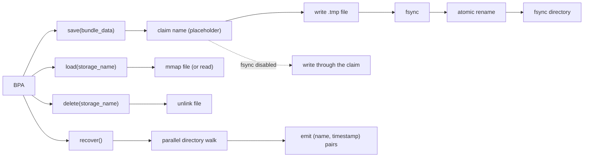

# hardy-localdisk-storage Design

Local filesystem bundle storage implementing the BundleStorage trait.

## Design Goals

- **Crash safety.** Bundle data must not be corrupted by power failure or process crash. Partial writes should never leave invalid state in storage.

- **Filesystem-friendly.** Avoid creating too many files in a single directory, which degrades performance on many filesystems. Distribute files across subdirectories.

- **Zero-copy loading.** Support memory-mapped file access where possible, allowing the kernel to handle caching and avoiding explicit read operations.

- **Parallel recovery.** On restart, scan the storage directory quickly using multiple threads to minimise startup time.

## Architecture Overview

The storage maps bundle identifiers to files on the local filesystem:

Bundles are stored in a two-level directory hierarchy (256 x 256 directories) with random filenames. This distribution prevents any single directory from accumulating too many entries.

## Key Design Decisions

### Two-Level Directory Hierarchy

Many filesystems slow down significantly when directories contain thousands of files. The two-level structure (`ab/cd/12345678`) provides 65,536 possible parent directories, keeping individual directories small even with millions of bundles.

File names are random 32-bit hex values. On collision, the value is incremented until a unique name is found. The randomness avoids predictable patterns that might interact poorly with filesystem caching or create hot directories.

### Atomic Write Protocol

Writes follow a careful protocol to ensure crash safety:

1. Claim the final name with an exclusive create, which leaves a zero-length placeholder under it; where the claim had to create the bucket, `fsync` the two directories above it
2. Write bundle data to a temporary file (`.tmp` extension) beside the placeholder
3. `fsync` the temporary file to ensure data reaches disk
4. Atomic rename from temporary to final path, replacing the placeholder
5. `fsync` the bucket directory to ensure the rename is durable

This protocol means bundles are either fully present or fully absent. A crash before step 4 leaves a `.tmp` file and a zero-length placeholder, both of which recovery cleans up. A crash after step 4 leaves a complete bundle.

The placeholder is what makes the rename safe. A rename replaces whatever holds the destination name, so the name must already be this save's own: the exclusive create fails where a stored bundle or a concurrent save holds it, and the save moves to the next name. Renaming without the claim was rejected, since a name collision, however rare, would silently replace a stored bundle. Publishing with a hard link, which does refuse to replace, would avoid the placeholder but is unavailable on FAT, exFAT and some network filesystems.

A save that fails removes what it created. The placeholder and the temporary file are each removed on any error return, so a store that is failing saves, a full disk for instance, does not accumulate a zero-length file per attempt. A `.tmp` file found where the save's own belongs was left by an earlier process: its name derives from the name just claimed, which no live save shares, so it is removed and the save proceeds. Failing the save there was rejected, because the BPA treats a failed save as fatal, and one stale file would stop the node.

The bucket directory is created only when the claim finds it missing. A save into an existing bucket, the usual case once a store has run for a while, then makes no directory call at all. If the recovery walk removes an empty bucket between its creation and the claim, the claim creates it again. It does so a bounded number of times: the walk visits each directory once, so it can take a bucket from under a claim once, and a bucket still missing after that fails the save with the filesystem's error, so the claim cannot retry without end.

The directory syncs are best effort: a failure is logged and the save stands, its data already synced, because some filesystems refuse to sync a directory. A new bucket is named by entries that are new too, its own and possibly its parent's, so the save that creates a bucket syncs the two directories above it, and does so straight after the claim: were it left to the end, a save that created the bucket and then failed would leave them unsynced for a later save that finds the bucket already there. Windows has no directory sync, so these steps are skipped there and the rename's durability is the filesystem's.

The `fsync` operations have performance cost. Configuration allows disabling them for deployments where the underlying storage provides its own durability guarantees (e.g., battery-backed RAID controllers, ZFS with synchronous writes). With `fsync` disabled, `save` skips the temporary file too: the exclusive create that claims the final name is also the file the bundle is written through, in one step, so the name is protected as in the atomic protocol and no file is opened twice. A crash can leave an empty or partial file under its final name. Nothing references it, because metadata is inserted only after `save` returns, and recovery discards it, the empty file as a placeholder and the partial one as unparseable.

An unsynced save checks only the write itself. An error the filesystem reports later, at write-back or as the file is closed (a network filesystem's deferred write, a quota), is not seen, because observing it takes the sync this mode exists to skip. A deployment that needs such errors reported keeps `fsync` enabled.

### Memory-Mapped Loading

When the `mmap` feature is enabled, bundle loading uses memory-mapped files instead of explicit reads. The kernel maps the file into the process address space; actual disk reads happen on demand as pages are accessed.

This provides several benefits: the kernel manages caching automatically, multiple readers of the same bundle share physical memory, and large bundles don't require contiguous heap allocation.

The trade-off is that memory-mapped files don't work reliably on network filesystems (NFS, SMB). For such deployments, the feature can be disabled to use explicit reads instead.

### Parallel Recovery Walk

On startup, the storage performs a parallel directory walk using multiple threads. Each thread processes subdirectories independently, emitting `(storage_name, creation_timestamp)` pairs to a recovery channel.

The walk applies several cleanup rules:

- Temporary files (`.tmp` extension) are deleted as incomplete writes
- Zero-length placeholder files are deleted
- Empty directories are removed after processing
- Files created after the walk started are ignored (they're new bundles being written concurrently)

The timestamp check prevents a race condition where concurrent writes could be mistaken for recovery candidates.

#### Internal flume + bridge pump

The walk runs inside `tokio::task::spawn_blocking` and uses `std::fs` (synchronous I/O), so it needs a blocking-friendly channel for emitting results. The trait surface, however, takes a `&dyn Sender<RecoveryResponse>` (see [bpa storage subsystem design](../../bpa/docs/storage_subsystem_design.md#streaming-results-via-sendert)) — async-only.

`recover()` bridges these by creating an internal `flume::bounded(parallelism * 16)`: the walk tasks `flume::Sender::send` into it (blocking, with `is_disconnected()` early-exit), and a sibling pump task in the same `recover()` future pulls from the flume receiver and forwards items to the external `Sender` via `send().await`. When the walk completes it drops its `flume_tx`, the pump's `recv_async` returns `Disconnected`, and the pump exits. When the external consumer goes away first, the pump's `stream.send` errors, the pump returns and drops `flume_rx`, and the walk's next `is_disconnected()` check stops the walk.

This keeps the existing walk code unchanged while presenting the `Sender`-shaped trait surface.

## Configuration

| Option | Default | Purpose |
|--------|---------|---------|
| `store_dir` | Platform-specific | Root directory for bundle storage |
| `fsync` | `true` | Enable fsync for crash safety (disable for hardware-backed durability) |

Default directories follow platform conventions: `~/.cache/` on Linux, `~/Library/Caches/` on macOS, `%LOCALAPPDATA%` on Windows.

## Integration

### With hardy-bpa

Implements the `BundleStorage` trait. The BPA calls `save()`, `load()`, `delete()`, and `recover()` without knowing the underlying storage mechanism.

### With hardy-bpa-server

The server instantiates localdisk-storage based on configuration and injects it into the BPA.

## Dependencies

| Crate | Purpose |
|-------|---------|
| hardy-bpa | `BundleStorage` trait definition |
| memmap2 | Memory-mapped file I/O (optional `mmap` feature) |
| directories | Platform-specific default paths |
| tokio | Async filesystem operations |

## Future Work

- **Capacity limits and eviction.** Configurable maximum storage capacity with eviction policies when capacity is reached, integrated with BPA's `storage_priority` metadata.

- **Spool-and-commit engine for streaming storage.** When the streaming `BundleStorage::store`/`load` traits land (see [streaming pipeline design](../../bpa/docs/streaming_pipeline_design.md)), the write path becomes a two-stage engine. *Spool stage:* one spool file per in-flight bundle, segments appended as they are pulled from the `Receiver`; backpressure propagates to the CLA through the pull model rather than a queue depth, and a small bundle arriving as a single segment degenerates to the current single-write path. *Commit stage:* completed spools enqueue to a commit queue serviced by one IO thread; commits are batched and grouped by parent directory — one fsync per data file plus coalesced directory fsyncs per batch — under a configurable durability ladder (none / data-only / full per-commit / batched-full). Bucket selection can deliberately bias commits within a batching window into the same `xx/yy` bucket to maximise directory-fsync coalescing. The existing tmp-write → rename commit is already the atomic spool commit the streaming design requires. The motivating problem is measurable today — each `save()` costs one `spawn_blocking` and an unamortised per-file fsync — but the rework should land with the streaming traits, not before, because batching whole-buffer writes would be thrown away by the switch to segment spooling.

### Recovery Independent of the Clock

The recovery walk decides which files to report by comparing each file's time with the time the walk began: anything newer is taken for a bundle being saved while the walk runs, and skipped. That makes the walk's answer depend on the clock agreeing with the last run's. A clock that steps backwards between runs makes every stored file look newer than the walk, so the walk reports nothing, and the BPA, told that no bundle has data, removes every metadata record and reports each bundle deleted. The same comparison is what stops the walk deleting a live save's placeholder or `.tmp` file, so after a backward step a save running beside the walk is not protected either.

The design has two parts. The walk stops reading the clock, so that recovery is correct whatever the clock does and however the last run ended. And the store says, when it starts, whether a walk is needed at all, from whether it finds the mark the last run left by closing in order.

**A file name carries the run that wrote it.** Each time the store opens for writing it takes a run identifier, a random value kept in memory, and every name it creates in that run starts with it: the bundle's final name, and its placeholder and `.tmp` file. The walk reads only the name. A file whose name carries the current run's identifier was created by this process and is left alone, neither reported nor deleted; any other file is from an earlier run, and is reported if it is a bundle and removed if it is a placeholder or a `.tmp` file. The identifier is 64 bits, drawn at random, so two runs sharing one is not a case the store handles. Three alternatives are rejected:

- **Comparing file times with the walk's start.** This is the comparison the section removes: its answer is only as good as the clock.
- **A set of the names saved since the store opened, held in memory.** It answers the same question without touching names, but it grows with every save for as long as a walk runs, and the walk and every save must share it.
- **Assuming the store is idle while the walk runs.** The BPA saves through the store during recovery, when it re-admits a bundle whose metadata is missing, so the walk and saves do overlap.

A file with no run identifier in its name is an earlier run's. The name of a stored bundle is opaque to the BPA, so the longer name changes nothing outside this crate.

**A file's time is reported, never decided on.** The walk reads each reported file's time, because the BPA uses it as the received time of a bundle it re-admits. No file is kept, skipped or removed because of its time.

**A mark on disk says the last run closed in order.** A file in the store directory, `.clean`, is removed when the store opens for writing, with the directory synced before any bundle is touched, and written back, with the directory synced again, when the store closes in order. It is touched twice in a run and never in between. A run that ends any other way, a kill, a panic or a power loss, leaves no mark, and the next start finds none. The file is empty: its presence is the whole of what it says. The walk leaves it alone: it removes zero-length files and reports the rest as bundles, in the buckets only, and takes no file in the store directory itself for either. The mark is this backend's own, in the terms of the [storage consistency design](../../bpa/docs/storage_consistency_updates.md): what it implies is decided here, and no other component reads it.

The mark is what says "no walk", and its absence asks for one. The opposite sense, a mark created at open and removed at close so that a leftover mark asks for a walk, is rejected: a store directory that has never held a mark, one written by an earlier version or assembled by hand, would then read as closed in order and skip the walk it most needs. With the absence asking, every state the store cannot vouch for errs towards checking.

A missing mark does not mean a save was in flight. The run may have been idle for hours when it died. The store asks for a walk all the same: a process that ended without closing its store has given no account of what it was doing, and checking is cheap beside being wrong. A mark that tracked activity instead, cleared by the first save after an idle spell and written back once the store had been quiet for a while, is rejected. It would spare the walk after an abort that caught the store idle, at the cost of two directory syncs for every burst of work, a timer, and a claim, "nothing was in flight", that is narrower than the question a restart is asking.

Closing in order is the shutdown call the BPA makes on each of its stores once it has stopped saving, and the mark is how this backend keeps the record that call asks for ([storage subsystem design](../../bpa/docs/storage_subsystem_design.md#recovery-on-demand-proposal)). The mark is synced with `fsync` disabled too: it is two syncs a run, and unsynced its removal could be lost in the crash it is there to report.

**On start, the store says whether a walk is needed.** Opening the store returns one of two answers, read before this run removes the mark:

- **A walk is needed.** The `.clean` mark is absent: the last run did not close its store, or the store has never been closed by a version that marks it. A placeholder, a `.tmp` file or a partly written bundle may be in the buckets, and a bundle may be on disk that the BPA never recorded. The store also asks for a walk where it cannot tell whether the mark is there.
- **No walk is needed.** The mark is present: the last run closed its store, after the BPA had stopped saving, so every save had returned and the buckets hold only complete bundles.

The answer is about this backend's files only. The metadata store gives its own, and the BPA runs recovery when either asks, so a node that crashes and is restarted by its supervisor checks its stores without being told to, where the walk runs only when the operator passes `--recover-store`.

A node that is stopped and started in order skips the walk. On a large store that is worth having: a walk costs about ten microseconds a file on ext4 with a warm cache, some two seconds for 200,000 bundles, and the BPA's re-read of each bundle costs several times that.

**The walk can report without removing.** The walk changes the store as it goes: it deletes placeholders and `.tmp` files and removes empty directories, and it tells its caller about none of them. For a check that repairs nothing ([storage subsystem design](../../bpa/docs/storage_subsystem_design.md#recovery-on-demand-proposal)) the walk takes a flag that turns the deletions off, and in either mode it reports each leftover file it meets alongside the bundles, so the BPA can count them and name them in its summary. A check-only walk leaves the `.clean` mark as it found it.

**The clock is not checked here.** With the walk deciding by name, nothing in this backend depends on the clock, so it keeps no time baseline and takes no action when the clock moves. A clock that has gone backwards still matters to bundle lifetimes, and that is the BPA's to detect and to answer, with the clock baseline the storage consistency design gives the metadata store; the answer there is to warn and carry on, since a node whose clock may be wrong at every power-up loses more by refusing to store bundles than a stale clock costs it.

## Testing

- [Test Plan](test_plan.md) - Filesystem persistence verification
