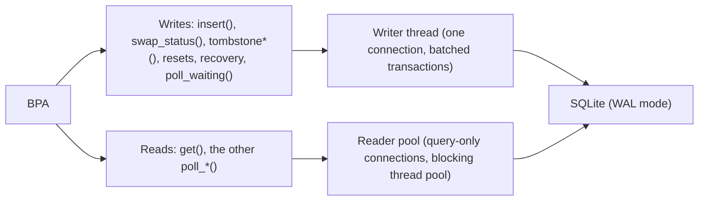

# hardy-sqlite-storage Design

SQLite-based metadata storage implementing the MetadataStorage trait.

## Design Goals

- **Serverless operation.** Use an embedded database that requires no separate server process. SQLite provides ACID guarantees in a single-file format.

- **Efficient queries.** Support fast lookup by bundle ID, polling by status, and ordering by expiry time. Index the fields used in frequent queries.

- **Concurrent access.** Allow multiple readers while supporting serialised writes. The BPA's parallel processing model requires concurrent metadata access.

- **A non-blocking runtime.** Keep SQLite's blocking I/O off the async runtime's worker threads, so a slow write or checkpoint never stalls unrelated tasks.

- **Schema evolution.** Support database migrations when the schema changes between versions without requiring manual intervention.

## Architecture Overview

The storage layer sits between the BPA and a SQLite database file:

Bundle metadata is serialised as JSON and stored alongside indexed columns that enable efficient querying without deserialising every row. Every write runs on a single dedicated writer thread that owns the only writing connection; reads run on a bounded pool of query-only connections on Tokio's blocking thread pool. No SQLite call runs on an async worker thread.

## Key Design Decisions

### Embedded SQLite vs External Database

SQLite was chosen over external databases (PostgreSQL, Redis) for several reasons.

It's serverless and file-based. No database server needs to be deployed, configured, or monitored. The database is a single file that can be backed up by copying.

It's embeddable. The SQLite library compiles directly into the application. There's no network communication overhead or connection establishment latency.

It has excellent tooling. Standard tools can inspect and modify the database for debugging or maintenance. The file format is stable and well-documented.

### WAL Mode for Concurrent Access

The database uses Write-Ahead Logging (WAL) mode rather than the default rollback journal, applied at connection setup — journal mode cannot be changed inside the migration transaction, so it cannot live in the schema files. This choice directly supports the BPA's access pattern where the dispatcher reads metadata frequently while the store writes updates.

In WAL mode, readers don't block writers and writers don't block readers. Readers see a consistent snapshot even during writes. This is critical because bundle processing involves frequent metadata lookups that shouldn't stall behind write operations.

The trade-off is additional disk space for the WAL file and slightly more complex recovery, but these are acceptable given the concurrency benefits.

### Indexed Status Fields with Serialised Metadata

Bundle metadata is stored as a serialised JSON blob, but key fields (status, expiry, received_at) are duplicated in indexed columns. This duplication is intentional.

The alternative would be to deserialise every row when querying by status or expiry. For a store with thousands of bundles, this would be prohibitively slow. By extracting queryable fields into indexed columns, the database can filter efficiently and only deserialise the rows that match.

The status is encoded as a numeric code with parameters rather than as a string or JSON. Numeric comparisons are faster and indexes on integers are more compact.

### Status Columns as Source of Truth

The processing status is stored only in the indexed columns: the serialised blob is the BPA's `StoredBundle` record — the wire bundle and its `BundleMetadata` — which carries no status. Every read path (`get`, `confirm_exists`, `poll_expiry`, `poll_waiting`, `poll_pending`, `poll_adu_fragments`, `poll_service_waiting`) re-imposes the status through `StoredBundle::into_bundle`, either decoding the columns with `to_status()` or taking the status the query filtered on, so the blob and the columns cannot disagree about it.

This matters most for status transitions, which touch only the columns. `swap_status` is a conditional compare-and-swap on the status columns, and the queue sweeps (`reset_peer_queue`, `reset_peer_ack_pending`, `reset_service_queue`) can touch many rows and may be called frequently (whenever a peer connection drops); each is a single `UPDATE … SET status_code = …` rather than a deserialise and re-serialise of every matching bundle.

The trade-off is a small amount of extra work on every read (extracting and mapping the status columns), but this cost is negligible compared to the I/O already involved in reading the row. The benefit is that status transitions remain simple SQL updates with no serialisation overhead.

### A Single Writer Thread with Opportunistic Batching

SQLite allows one writer at a time, so writes must be serialised somewhere. They are serialised on a dedicated OS thread that owns the store's only writing connection. Each trait method submits its write to the thread as a closure over a queue and awaits the reply. The thread runs in arrival order, so writers never race for SQLite's write lock or retry on `SQLITE_BUSY`.

Running the writes on their own thread keeps them off Tokio's async workers. A SQLite write is blocking I/O, and under `synchronous = NORMAL` the occasional write that crosses the WAL auto-checkpoint threshold performs the checkpoint's fsync inline. On a worker thread that would stall every task scheduled there.

The writer batches without a timer. It blocks until a write arrives, then takes whatever else has queued meanwhile (up to 64 writes) and runs the batch in one transaction, with each write in its own savepoint. An idle store therefore commits each write on its own with no added latency, while under load the batches grow by themselves and the per-transaction cost is shared. The savepoints keep each write atomic and independent: a write that fails rolls back alone and the rest of the batch commits. Every caller is answered only after its batch's commit has resolved, so no caller acts on a write that did not commit, and if the commit itself fails, every write in the batch reports the failure. A write whose caller has already gone by the time its turn comes is skipped.

The trade-off is one cross-thread hand-off per operation, which adds roughly a tenth of a millisecond of latency. A strictly sequential caller is therefore slower than running SQLite inline: in a local benchmark of the forwarding lifecycle's metadata traffic, a little over half the throughput. The two break even at between one and four concurrent callers, and with dozens in flight the batching roughly doubles throughput. The BPA's workload is concurrent, and a bundle's metadata writes sit beside bundle-data I/O that costs far more, so the design favours throughput under load and an unblocked runtime.

Rejected alternatives:

- **A Tokio mutex around a pooled connection.** It serialises writes but runs them, and their checkpoints, on async workers, and every write pays its own transaction.
- **A batching window.** Waiting a few milliseconds to collect writes adds that delay to every write on a lightly loaded node, where nothing would have joined the batch anyway.
- **Batching only inserts.** After ingress, a bundle's writes are mostly conditional status swaps and tombstones, so insert-only batching would leave most of the traffic unbatched.

### Pooled Readers off the Async Runtime

Reads run on Tokio's blocking thread pool, each on a connection taken from a pool bounded at one connection per hardware thread. The connections are query-only (`PRAGMA query_only`), so a write routed through them by mistake fails rather than racing the writer. Under WAL a reader sees a consistent snapshot and never blocks or waits on the writer. Because the writer answers a caller only after the commit, a read issued after a write's reply always sees that write.

Tokio's blocking pool already provides the threads, so the store keeps no reader threads of its own. Reader connections are separate from the writing connection, so each commit invalidates a reader's page cache and the next read re-fetches its pages from the WAL. That cost is accepted to keep reads concurrent with writes.

### Flyway-Inspired Migration

Schema migrations follow the pattern established by Flyway: numbered SQL files applied in sequence, with checksums to detect tampering.

Migration files are embedded at compile time, so there's no risk of missing migration scripts at runtime. Each migration's hash is stored in the database; if a hash doesn't match on startup, the storage refuses to open (indicating the schema was modified outside the migration system).

The `upgrade` argument to `SqliteStorage::new` (hardy-bpa-server's `--upgrade-store` flag) allows administrators to control when migrations run. In production, this prevents unexpected schema changes during routine restarts.

## Recovery Support

The MetadataStorage trait requires a recovery protocol to synchronise metadata with bundle data after crashes. The implementation uses an "unconfirmed" table to track entries during recovery:

1. **start_recovery()** - All existing entries are marked unconfirmed
2. **confirm_exists()** - As the BPA finds bundle data on disk, it confirms each entry
3. **remove_unconfirmed()** - Entries without corresponding data are reported and removed

This protocol handles the case where a crash occurred after writing bundle data but before updating metadata, or vice versa.

## Configuration

| Option | Default | Purpose |
|--------|---------|---------|
| `db_dir` | Platform-specific | Directory containing the database file |
| `db_name` | `metadata.db` | Database filename |

Default directories follow platform conventions: `~/.cache/` on Linux, `~/Library/Caches/` on macOS, `%LOCALAPPDATA%` on Windows. Fallback paths are used when user directories aren't available.

## Integration

### With hardy-bpa

Implements the `MetadataStorage` trait. The BPA calls trait methods for bundle lifecycle management without knowing the underlying storage mechanism.

### With hardy-bpa-server

The server instantiates sqlite-storage based on configuration and injects it into the BPA.

## Dependencies

| Crate | Purpose |
|-------|---------|
| hardy-bpa | `MetadataStorage` trait definition |
| rusqlite | SQLite database access (bundled SQLite) |
| serde_json | Bundle serialisation |
| directories | Platform-specific default paths |
| tokio | Writer queue and replies; the blocking thread pool for reads |

## Testing

- [Test Plan](test_plan.md) - SQLite metadata persistence verification
